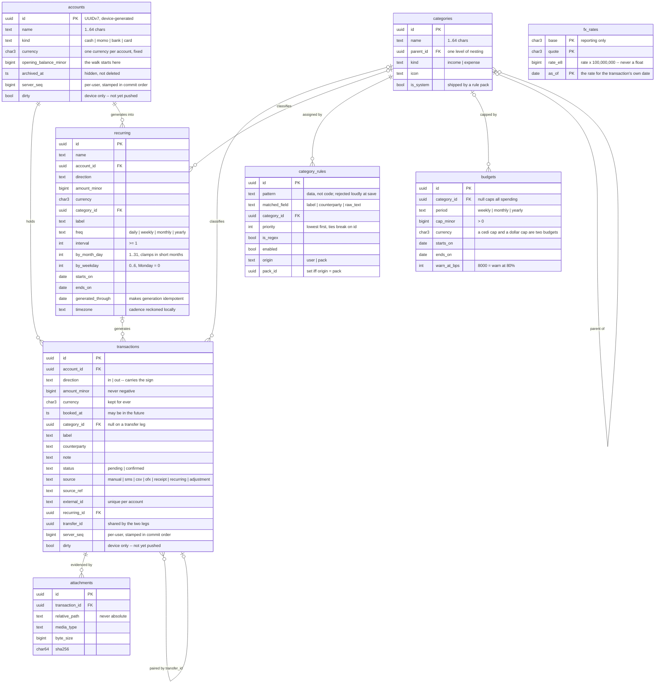
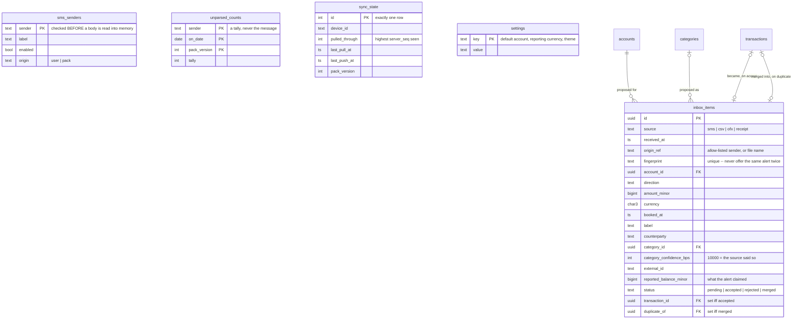
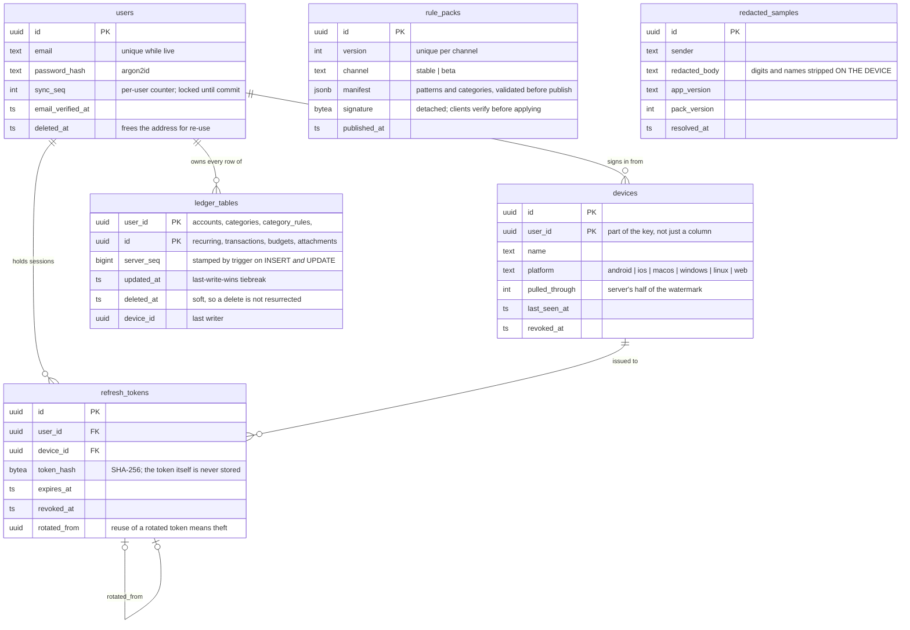

# Schema diagrams

Revision 1. Generated from `docs/diagrams/*.mmd` by `docs/diagrams/build.py` — edit the
`.mmd` files, not this page. The tables are described in [SCHEMA.md](SCHEMA.md).

GitHub renders the diagrams below. For a local render, open `docs/diagrams/index.html` in a
browser.

Every synced table also carries `created_at`, `updated_at`, `deleted_at` and `device_id`; the
Postgres copies carry `user_id` and `server_seq` as well. Those are left off the diagrams so
the shape stays readable.

## The ledger

Seven tables that exist in both databases and sync between them, plus the reporting rates. This is the part of the schema the product is actually about.

## On the device only

The review inbox and the SMS machinery. None of it syncs: only a confirmed transaction is allowed to leave the handset.

## On the server only

Identity, rule packs, and the columns every synced row carries. `ledger_tables` stands in for all seven, which share the same ownership and sync columns.

